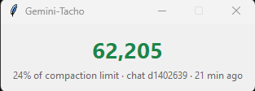
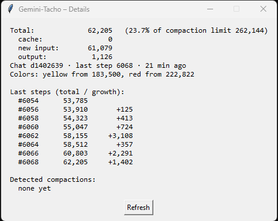

# Gemini-Tacho

A tiny context meter for **Google Antigravity**.

Antigravity compacts a chat automatically once the context gets full – without any warning and without
showing you how full it is. Gemini-Tacho shows the current token count of your active Antigravity chat,
so you know when it is time to save important things before the cut.

Made for the **Antigravity desktop app**, where extensions such as context monitors can't be installed.
It only reads the transcript files on disk, so it should work with the IDE as well (tested with the desktop app).

- **green** – plenty of room
- **yellow** (from ~183k tokens) – save what matters
- **red** (from ~223k tokens) – compaction can happen any moment





Two variants:

| File | What it does | Needs |
|---|---|---|
| `gemini_tacho.py` | small always-on-top window with the number | Python only (tkinter) |
| `gemini_tacho_tray.py` | ring icon in the Windows taskbar tray, hover for the number, click for details, alert when it turns red | `pystray`, `Pillow` |

When the tray version turns red, it shows a Windows balloon **and** a red always-on-top window that stays
until you click OK – so you don't miss it when you were away. Once per chat; after a compaction it is armed
again.

## How it works

Antigravity writes token counts after every step to

```
~/.gemini/antigravity/brain/<chat-id>/.system_generated/logs/transcript.jsonl
```

The tacho picks the most recently modified chat, reads **only the end of that file and only the number
fields** (`input_tokens`, `cache_read_tokens`, `output_tokens`) and adds them up. It never reads your chat
content and sends nothing anywhere.

When the count suddenly drops below 60 % in the same chat, a compaction happened; both versions log
this to `compactions.txt` next to the script (kept out of the repo by `.gitignore`).

## Thresholds

In October 2026 the last value before an automatic compaction was measured between **243,696 and 265,166**
tokens (9 cases), so roughly around 256 Ki (262,144). Yellow and red are set below the earliest case.
If your values differ, adjust `WINDOW`, `YELLOW_FROM` and `RED_FROM` at the top of `gemini_tacho.py`.

## Start

```
pythonw gemini_tacho.py
```

or the tray version:

```
pip install -r requirements.txt
pythonw gemini_tacho_tray.py
```

`pythonw` starts without a console window. To start it with Windows, put a shortcut into the startup folder
(`Win + R` → `shell:startup`).

## Caveats

- The transcript format is **not documented** by Google. An Antigravity update can change it and break the tacho.
- Tested on Windows 11 with Antigravity up to v2.29.0 only.
- Not affiliated with Google. "Gemini" and "Antigravity" are trademarks of Google.

## Changelog

- **1.0.1** – Tray version: alert (balloon + red window until OK) when the tacho turns red, once per chat.
- **1.0.0** – First release.
